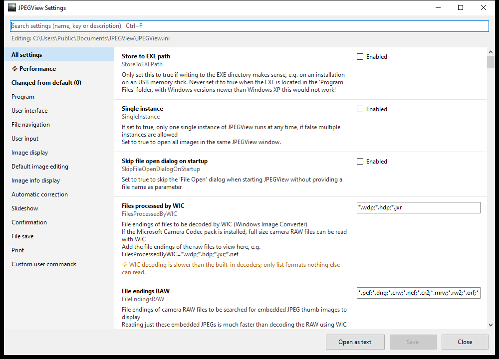
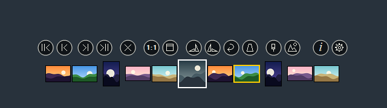
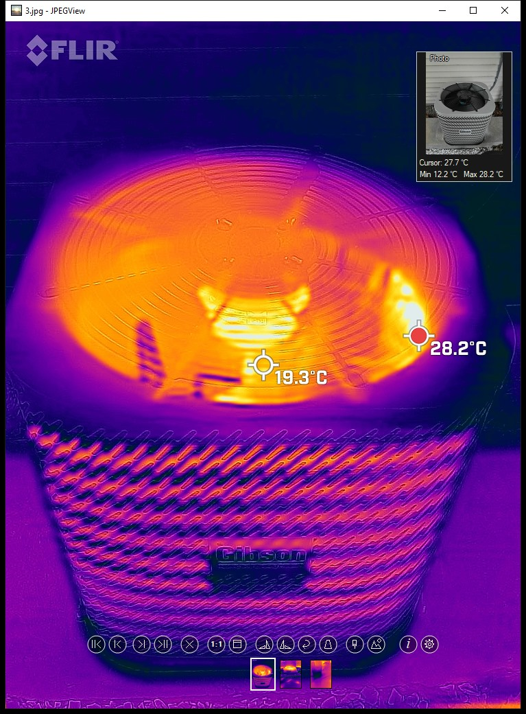

[](https://htmlpreview.github.io/?https://github.com/sylikc/jpegview/blob/master/src/JPEGView/Config/readme.html) [](#Localization) [](https://github.com/sylikc/jpegview/actions/workflows/build-release-x64.yml) [](#) [](https://github.com/sylikc/jpegview/blob/master/LICENSE.txt)

[](https://github.com/sylikc/jpegview/releases)[](#) [](https://winstall.app/apps/sylikc.JPEGView) [](https://portableapps.com/apps/graphics_pictures/jpegview_portable) [](https://scoop.sh/#/apps?q=%22jpegview-fork%22) [](https://community.chocolatey.org/packages/jpegview) [](https://www.npackd.org/p/jpegview)

# JPEGView - Image Viewer and Editor

> **This is a fork of [sylikc/jpegview](https://github.com/sylikc/jpegview).** It adds faster loading, a settings window, a modern navigation bar with thumbnails, touchpad and touch gestures, and support for FLIR thermal images. See [Changes in this fork](#changes-in-this-fork) and [Credits and licenses](#credits-and-licenses). Everything below that section is the original project description.

## Changes in this fork

### Faster loading
* The folder is listed once when an image is opened, instead of once per supported file type (about 35 passes before). Opening an image in a folder of 4,000 files went from 79 ms to 62 ms; the gain is larger on slow disks and network drives.
* A second JPEGView window no longer waits up to 250 ms for the first one unless `SingleInstance` or `SingleFullScreenInstance` is on.
* Fixed: the global `JPEGView.ini` next to the program was never read.
* Builds with the current Visual Studio (v145 toolset).

### Settings window
* New `JPEGViewSettings.exe` (C#, .NET Framework 4.8, included in Windows 10 and 11) replaces editing the INI file in Notepad.
* All settings with their explanations from the INI file, grouped by section, with checkboxes, lists, color and font pickers, search, a list of everything changed from the defaults, a list of the settings that affect loading speed, and reset to default.
* Opens from the new gear button in the navigation bar and from the "Edit user settings" menu entry when it is next to `JPEGView.exe`.



### Navigation bar
* Round buttons, drawn anti-aliased on a dark background so they are sharp on any image.
* When a key command is used (arrow keys, Home/End, Del, rotate, ...), the bar appears and the matching button lights up.
* The zoom mode (drag to zoom) button is replaced by a settings button.
* Thumbnail strip below the buttons, like the photo apps of phones: the current image in the middle (larger, with its aspect ratio and a white frame) and up to 5 images on each side. Click one to show it. The thumbnails come from the thumbnail cache of Windows Explorer and are loaded in the background; only the 11 shown are kept in memory. Setting: `ShowThumbnailStrip`.



### Touchpad, touch and mouse
* Precision touchpads: pinch to zoom, two finger swipe left or right for the next or previous image (one image per swipe), two finger pan of zoomed images.
* Two finger pinch and pan on touch screens, and for touch points injected by mouse tools.
* Smooth scrolling (touchpads, mice with free spinning or emulated touchpad scrolling) zooms like a mouse wheel by default; set `TouchpadScrollPans=true` to pan with it instead.
* Fixed: zooming with many small wheel steps got stuck at 100 %. Also fixed: `ZoomPausePercent` values other than 100 were treated as 100.

### FLIR thermal images
* Radiometric JPEGs of FLIR cameras (the main image is the thermal view, the photo of the visible light camera and the raw sensor values are embedded) show a navigator in the top right corner with the other view. Click it to swap the thermal view and the photo; zoom and position are kept.
* The navigator shows the temperature under the mouse cursor and the lowest and highest temperature of the image, calculated from the raw sensor values and the calibration stored by the camera (emissivity, reflected temperature, atmosphere).
* Opening normal images is not slowed down (only the markers at the start of a JPEG are checked). Setting: `ShowThermalData`.



## Credits and licenses

* **[JPEGView](https://github.com/sylikc/jpegview)** by Kevin M (sylikc) and the original [JPEGView](https://sourceforge.net/projects/jpegview/) by David Kleiner. **GPL-2.0 or later** (see [LICENSE.txt](LICENSE.txt) and [COPYING.txt](COPYING.txt)). This fork is distributed under the same license.
* **[FlirImageExtractor](https://github.com/fclairec/FlirImageExtractor)** (fclairec, forked from [nationaldronesau/FlirImageExtractor](https://github.com/nationaldronesau/FlirImageExtractor)), **MIT License**, Copyright (c) 2020 National Drones. Reference for the layout of the FLIR data and the conversion of raw sensor values to temperatures. No code is copied, the reading and conversion are written anew in C++.
* **[read_thermal.py](https://github.com/Nervengift/read_thermal.py)** by Nervengift, **CC0-1.0**. The project FlirImageExtractor was developed from.
* **[Thermimage](https://github.com/gtatters/Thermimage)** by Glenn J. Tattersall, **GPL-3.0**. Origin of the raw-to-temperature formula used by the projects above.
* **[libjpeg-turbo](https://libjpeg-turbo.org/)**, IJG License, Modified BSD License and zlib License. Already part of JPEGView; used to decode the embedded photo and the navigator previews.
* **[libpng](http://www.libpng.org/pub/png/libpng.html)**, PNG Reference Library License version 2. Already part of JPEGView; used to decode the raw thermal data, which FLIR stores as a 16-bit PNG.

# Original project description

This is the official re-release of JPEGView.

## Description

JPEGView is a lean, fast and highly configurable image viewer/editor with a minimal GUI.

### Formats Supported

JPEGView has built-in support the following formats:

* Popular: JPEG, GIF
* Lossless: BMP, PNG, TIFF, PSD
* Web: WEBP, JXL, HEIF/HEIC, AVIF
* Legacy: TGA, WDP, HDP, JXR
* Camera RAW formats:
  * Adobe (DNG), Canon (CRW, CR2, CR3), Nikon (NEF, NRW), Sony (ARW, SR2)
  * Olympus (ORF), Panasonic (RW2), Fujifilm (RAF)
  * Sigma (X3F), Pentax (PEF), Minolta (MRW), Kodak (KDC, DCR)
  * A full list is available here: [LibRaw supported cameras](https://www.libraw.org/supported-cameras)

Many additional formats are supported by Windows Imaging Component (WIC)

### Basic Image Editor

Basic on-the-fly image processing is provided - allowing adjusting typical parameters:

* sharpness
* color balance
* rotation
* perspective
* contrast
* local under-exposure/over-exposure

### Other Features

* Small and fast, uses AVX2/SSE2 and up to 4 CPU cores
* High quality resampling filter, preserving sharpness of images
* Basic image processing tools can be applied realtime during viewing
* Movie/Slideshow mode - to play folder of JPEGs as movie

# Installation

## Official Releases

Official releases will be made to [sylikc's GitHub Releases](https://github.com/sylikc/jpegview/releases) page.  Each release includes:

* **Archive Zip/7z** - Portable
* **Windows Installer MSI** - For Installs
* **Source code** - Build it yourself

## Portable

JPEGView _does not require installation_ to run.  Just **unzip, and run** either the 64-bit version, or the 32-bit version depending on which platform you're on.  It can save the settings to the extracted folder and run entirely portable.

## MSI Installer

For those who prefer to have JPEGView installed for All Users, a 32-bit/64-bit installer is available to download starting with v1.0.40.

(Unfortunately, I don't own a code signing certificate yet, so the MSI release is not signed.  Please verify checksums!)

### WinGet

If you're on Windows 11, or Windows 10 (build 1709 or later), you can also download it directly from the official [Microsoft WinGet tool](https://docs.microsoft.com/en-us/windows/package-manager/winget/) repository.  This downloads the latest MSI installer directly from GitHub for installation.

Example Usage:

C:\> `winget search jpegview`
```
Name     Id              Version  Source
-----------------------------------------
JPEGView sylikc.JPEGView 1.1.43  winget
```

C:\> `winget install jpegview`
```
Found JPEGView [sylikc.JPEGView] Version 1.1.43
This application is licensed to you by its owner.
Microsoft is not responsible for, nor does it grant any licenses to, third-party packages.
Downloading https://github.com/sylikc/jpegview/releases/download/v1.1.43/JPEGView64_en-us_1.1.43.msi
  ██████████████████████████████  4.23 MB / 4.23 MB
Successfully verified installer hash
Starting package install...
Successfully installed
```

## PortableApps

Another option is to use the official [JPEGView on PortableApps](https://portableapps.com/apps/graphics_pictures/jpegview_portable) package.  The PortableApps launcher preserves user settings in a separate directory from the extracted application directory.  This release is signed.

## Scoop

[Scoop](https://scoop.sh/) is a Windows command-line installer and manager for portable applications.

To install with Scoop, run the following commands:

```shell
scoop bucket add extras
scoop install extras/jpegview-fork
```

After installation, the configuration file is located at `%UserProfile%\scoop\persist\JPEGView-fork\JPEGView.ini`.

## System Requirements

* 64-bit version: Windows 7/8/10/11 64-bit or later
* 32-bit version: Windows 7 or later
  * A special _32-bit Windows XP SP2_ build is available, which supports most formats (except for formats added after v1.0.37.1, ex. Animated PNG, JXL, HEIC).  Other features and options are the same as the normal builds.

## What's New

* See what has changed in the [latest releases](https://github.com/sylikc/jpegview/releases)
* Or Check the [CHANGELOG.txt](https://github.com/sylikc/jpegview/blob/master/CHANGELOG.txt) to review new features in detail.

# Localization

By default, the language is auto-detected to match your Windows Locale.  All the text in the menus and user interface should show in your language.  To override the auto-detection, manually set `Language` option in `JPEGView.ini`

JPEGView is currently translated/localized to 28 languages:

| INI Option | Language |
| ---------- | -------- |
| be | Belarusian |
| bg | Bulgarian |
| cs | Czech |
| de | German |
| el | Greek, Modern |
| es-ar | Spanish (Argentina) |
| es | Spanish |
| eu | Basque |
| fi | Finnish |
| fr | French (Français) |
| hu | Hungarian |
| it | Italian |
| ja | Japanese (日本語) |
| ko | Korean (한국어) |
| pl | Polish |
| pt-br | Portuguese (Brazilian) |
| pt | Portuguese |
| ro | Romanian |
| ru | Russian (Русский) |
| sk | Slovak |
| sl | Slovenian (Slovenščina) |
| sr | Serbian (српски) |
| sv | Swedish |
| ta | Tamil |
| tr | Turkish (Türkçe) |
| uk | Ukrainian (Українська) |
| zh-tw | Chinese, Traditional (繁體中文) |
| zh | Chinese, Simplified (简体中文) |

See the [Localization wiki page](https://github.com/sylikc/jpegview/wiki/Localization#localization-status) for translation status for each language.

# Help / Documentation

The JPEGView documentation is a little out of the date at the moment, but should still give a good summary of the features.

This [readme.html](https://htmlpreview.github.io/?https://github.com/sylikc/jpegview/blob/master/src/JPEGView/Config/readme.html) is part of the JPEGView package.

# Brief History

This GitHub repo continues the legacy (is a "fork") of the excellent project [JPEGView by David Kleiner](https://sourceforge.net/projects/jpegview/).  Unfortunately, starting in 2020, the SourceForge project has essentially been abandoned, with the last update being [2018-02-24 (1.0.37)](https://sourceforge.net/projects/jpegview/files/jpegview/).  It's an excellent lightweight image viewer that I use almost daily!

The starting point for this repo was a direct clone from SourceForge SVN to GitHub Git.  By continuing this way, it retains all previous commits and all original author comments.

I'm hoping with this project, some devs might help me keep the project alive!  It's been awhile, and could use some new features or updates.  Looking forward to the community making suggestions, and devs will help with some do pull requests as some of the image code is quite a learning curve for me to pick it up. -sylikc

## Special Thanks

Special thanks to [qbnu](https://github.com/qbnu) for adding additional codec support!
* Animated WebP
* Animated PNG
* JPEG XL with animation support
* HEIF/HEIC/AVIF support
* QOI support
* ICC Profile support for WebP, JPEG XL, HEIF/HEIC, AVIF
* LibRaw support (all updated RAW formats, such as CR3)
* Photoshop PSD support

Thanks to all the _translators_ which keep JPEGView strings up-to-date in different languages!  See [CHANGELOG.txt](https://github.com/sylikc/jpegview/blob/master/CHANGELOG.txt) to find credits for translators at each release!
